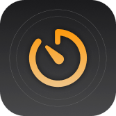
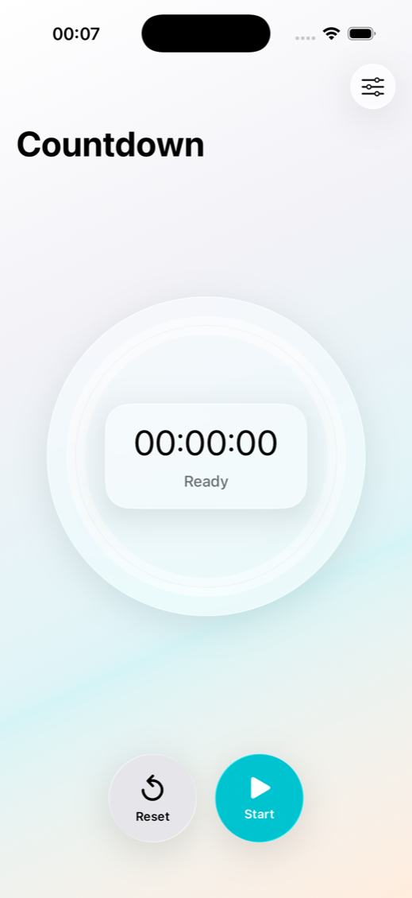
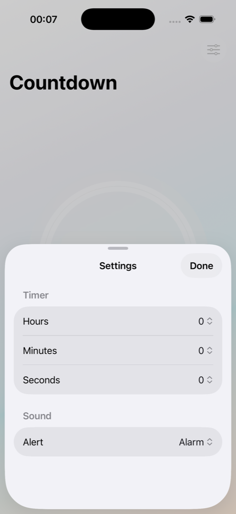
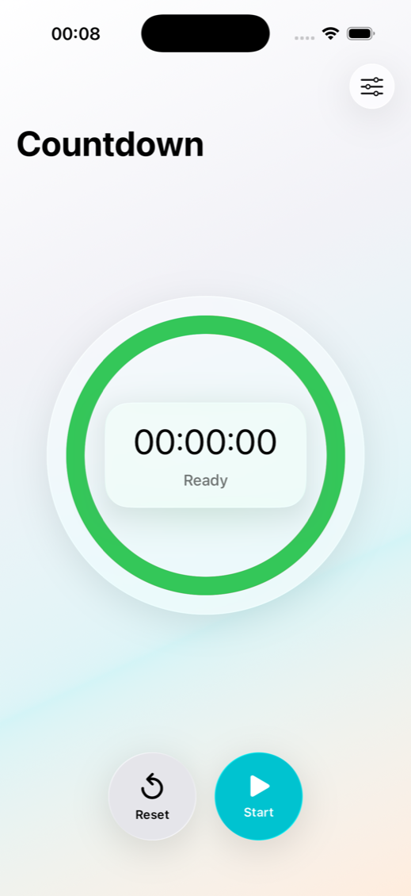

# Countdown

 

Countdown is a small SwiftUI timer app for everyday activities such as cooking meals, taking quizzes, giving speeches and playing sports. It supports start, pause, reset, duration selection, and optional system alert sounds.

The project has been modernized for iOS 26 with SwiftUI, Observation, NavigationStack, native sheet presentation, and Liquid Glass effects.

  
  
  

# Built With
[SwiftUI](https://developer.apple.com/xcode/swiftui/)

- iOS 26+
- SwiftUI Observation
- Liquid Glass
- Swift concurrency

# Contributing

Contributions are what make the open source community such a fantastic place to learn, share, inspire, and create. Any contributions you make are greatly appreciated.

- Fork the project
- Create your feature branch `git checkout -b feature/AmazingFeature`
- Commit your changes `git commit -m 'Add some AmazingFeature'`
- Push to the branch `git push origin feature/AmazingFeature`
- Open a pull request

# License

See [LICENSE](LICENSE)

# Contact

Leonardo Bilia - [@leonardobilia](https://twitter.com/leonardobilia)
